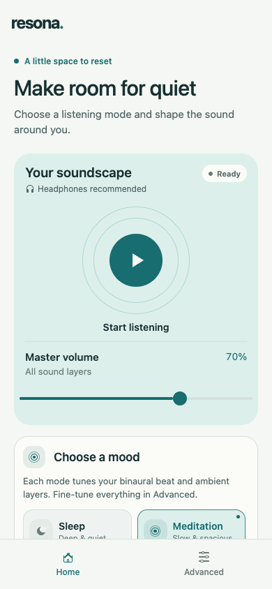
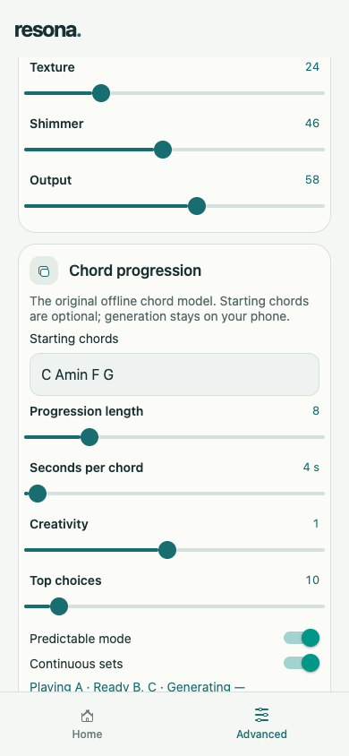

# Resona Lite

**A little space to reset.**

Resona Lite brings the sound of [Resona](https://github.com/Exabyte-Technologies/Resona)
to your phone. It creates an evolving mix of ambient music, gentle tones and natural
textures for moments when you want to rest, meditate, focus or take a quiet break.

Open the app, choose a mood and press play. There is no account to create, and the
music is made on your device.

## A look inside

<table>
  <tr>
    <td align="center"></td>
    <td align="center"></td>
  </tr>
  <tr>
    <td align="center"><strong>Start with a little quiet</strong><br />Your music, mood and volume in one place.</td>
    <td align="center"><strong>Let the harmony unfold</strong><br />Create a chord sequence and let it keep evolving.</td>
  </tr>
</table>

*Screenshots show the phone layout in the web preview. Appearance may vary slightly by device.*

## Find your mood

Choose **Sleep**, **Meditation**, **Focus** or **Awake** to set the feel of your
soundscape. Start or pause with one tap, and adjust the overall volume without
leaving Home. The **Layer balance** button on the playing card opens a small
mixer over Home, so you can adjust the three tracks while you listen.

On first launch, choose your language before a short welcome tour. English, 简体中文, 繁體中文,
Español, हिन्दी, العربية, Português, Français, Русский and 日本語 are available.
You can switch languages beside **Quick tour** at the bottom of Advanced.

You can skip the tour, go back through the steps, or open **Quick tour** at the bottom of Advanced whenever you want a reminder.

## Wind down with a timer

Below **Choose a mood**, set a sleep timer for 15, 30, 45, 60 or 90 minutes.
A countdown shows how long is left. It stops all sound tracks, including noise and
chord playback. Choose **Off** or **Cancel timer** to keep listening.

While a soundscape plays, iPhone shows lock-screen playback controls and Android
shows a media notification. Pause, play or stop from these controls; the Android
notification also lets you add **+15 min** to your sleep timer. Sound continues
when you switch apps or lock your phone. Closing the app completely ends the session.

## Make it your own

Visit **Advanced** when you feel like exploring. Blend soft musical layers, choose
a warmer or more spacious atmosphere, and add white, pink or brown noise—or textures
inspired by rain, the ocean and a forest. Each sound track has its own playback and
volume controls.

You can also choose a tonal centre—the note your music is built around—or create a
chord progression. Add starting chords if you have something in mind, or let Resona
Lite choose. Adjust the time between chords and how smoothly the ambient and
binaural layers move to each new chord on the same card. **Continuous sets**
keeps new harmony ready as you listen.

The app follows your phone’s light or dark appearance, and its gentle transitions
respect your system’s Reduce Motion setting.

Headphones are recommended, especially for binaural beats, which send slightly
different tones to each ear.

---

## Technical details

Resona Lite is an Expo SDK 58 / React Native app for iOS and Android, with an
optional web preview. It bundles Resona’s original Web Audio engine and offline
chord model. Audio runs in a persistent local WebView on mobile and an iframe on
web. Playback and chord generation use local assets; no account, microphone or
chat/voice agent is required. Tutorial completion and your chosen language are stored on the device. Arabic uses
a right-to-left layout. The launch screen holds for half a second after preferences
load, then fades over 250 ms.

### Run locally

```sh
cd resona-lite
npm ci
npm start
```

Use `npm run ios` or `npm run android` for a native build. Existing development
installs need a fresh native build for background playback and notifications.
Background playback is unavailable in Expo Go; use a development or EAS build.

### Checks

```sh
npm test
npm run typecheck
npm run lint
npx expo export --platform web
```

Optional checks, with their dependencies installed:

```sh
# Playwright: compare rendered audio with the original Resona source.
RESONA_SOURCE=/path/to/Resona/resona/static/js/audio.js node scripts/verify-render.cjs

# esbuild + jsdom: check the tutorial flow and saved completion.
node scripts/verify-tutorial.cjs
node scripts/verify-tutorial.cjs --motion
```

The audio comparison uses matching random input. Separate listening sessions can
produce different chords, textures and note timing.

See the [audio parity notes](resona-lite/docs/audio-parity.md) for the comparison and
verification details, and [upstream attribution](resona-lite/src/engine/vendor/PROVENANCE.md)
for the original engine and model sources.

### Background playback

iOS playback uses the native playback audio session and background audio mode;
Android uses a foreground media service and a monochrome notification icon. Both
platforms route media controls into the original Web Audio engine in the persistent
WebView. No push server or account is used.

The original engine's audio clock and chords advanced while hidden in an iOS
simulator probe. For a phone check, build and install the iOS `preview` profile
from `resona-lite/`:

```sh
npx eas-cli@latest build --platform ios --profile preview
```

Start a soundscape, then lock the phone or switch apps. Check that the audio
continues and verify **Pause**, **Play** and **Stop** from the iOS lock-screen
controls. On Android, repeat the check with the media notification and verify
**+15 min** timer extension. Force-quitting ends the session.

The sleep timer uses an absolute deadline and checks expiry before audio resumes.
Its bridge also cancels pending noise restarts and continuous chord generation when
stopping a session. Timer state lasts for the current app process; a cold start is silent.
