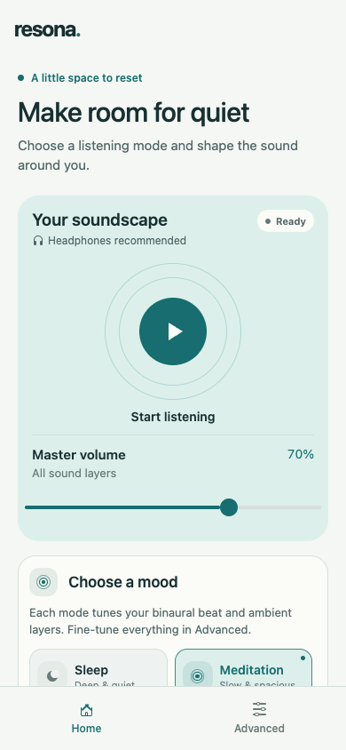
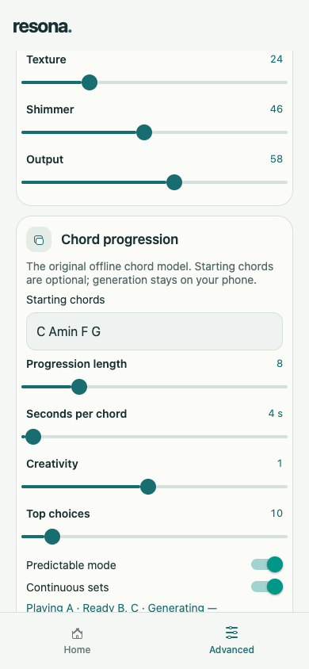

# Resona Lite

**A little space to reset.**

Resona Lite brings the sound of [Resona](https://github.com/Exabyte-Technologies/Resona)
to your phone. It creates an evolving mix of ambient music, gentle tones and natural
textures for moments when you want to rest, meditate, focus or take a quiet break.

Open the app, choose a mood and press play. There is no account to create, and the
music is made on your device.

## A look inside

<table>
  <tr>
    <td align="center"></td>
    <td align="center"></td>
  </tr>
  <tr>
    <td align="center"><strong>Start with a little quiet</strong><br />Your music, mood and volume in one place.</td>
    <td align="center"><strong>Let the harmony unfold</strong><br />Create a chord sequence and let it keep evolving.</td>
  </tr>
</table>

*Screenshots show the phone layout in the web preview. Appearance may vary slightly by device.*

## Find your mood

Choose **Sleep**, **Meditation**, **Focus** or **Awake** to set the feel of your
soundscape. Start or pause with one tap, and adjust the overall volume without
leaving Home. The **Layer balance** button on the playing card opens a small
mixer over Home, so you can adjust the three tracks while you listen.

A short tour welcomes you on first launch. You can skip it, go back through the
steps, or open **Quick tour** at the bottom of Advanced whenever you want a reminder.

## Make it your own

Visit **Advanced** when you feel like exploring. Blend soft musical layers, choose
a warmer or more spacious atmosphere, and add white, pink or brown noise—or textures
inspired by rain, the ocean and a forest. Each sound track has its own playback and
volume controls.

You can also choose a tonal centre—the note your music is built around—or create a
chord progression. Add starting chords if you have something in mind, or let Resona
Lite choose. **Continuous sets** keeps new harmony ready as you listen.

The app follows your phone’s light or dark appearance, and its gentle transitions
respect your system’s Reduce Motion setting.

Headphones are recommended, especially for binaural beats, which send slightly
different tones to each ear. **Playback currently works while the app is in the
foreground; background playback is not yet supported.**

---

## Technical details

Resona Lite is an Expo SDK 58 / React Native app for iOS and Android, with an
optional web preview. It bundles Resona’s original Web Audio engine and offline
chord model. Audio runs in a persistent local WebView on mobile and an iframe on
web. Playback and chord generation use local assets; no account, microphone or
chat/voice agent is required. Tutorial completion is stored on the device.

### Run locally

```sh
npm ci
npm start
```

Use `npm run ios` or `npm run android` for a native build. Existing development
installs need a rebuild to include the WebView dependency. Expo Go must match SDK 58.

### Checks

```sh
npm test
npm run typecheck
npm run lint
npx expo export --platform web
```

Optional checks, with their dependencies installed:

```sh
# Playwright: compare rendered audio with the original Resona source.
RESONA_SOURCE=/path/to/Resona/resona/static/js/audio.js node scripts/verify-render.cjs

# esbuild + jsdom: check the tutorial flow and saved completion.
node scripts/verify-tutorial.cjs
node scripts/verify-tutorial.cjs --motion
node scripts/verify-home-mixer.cjs
```

The audio comparison uses matching random input. Separate listening sessions can
produce different chords, textures and note timing.

See the [audio parity notes](docs/audio-parity.md) for the comparison and
verification details, and [upstream attribution](src/engine/vendor/PROVENANCE.md)
for the original engine and model sources.
